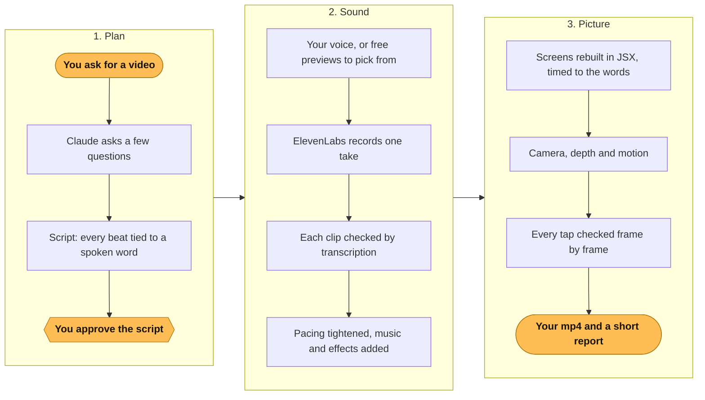

# JSXMotion

**Narrated videos written like apps.** A Claude Code skill that rebuilds your app's screens in JSX, animates them with Remotion, voices them with ElevenLabs, and lands every frame on the spoken word.

Ask Claude for a video the way you'd ask for a feature: an app walkthrough, an announcement from a storyboard image, or a 30 second promo. JSXMotion gives Claude the whole pipeline, from questions and script to voice, scenes, QA and the final mp4. One skill serves every project you have.

[](https://github.com/VisroliyaHimanshu/jsxmotion/releases/tag/demo-video)

**▶ [Download the 30 second how to video (mp4, with sound)](https://github.com/VisroliyaHimanshu/jsxmotion/releases/download/demo-video/jsxmotion-how-to.mp4)**, made with JSXMotion itself.

- [What it does](#what-it-does)
- [How it works](#how-it-works)
- [Install](#install)
- [Requirements](#requirements)
- [Keys](#keys)
- [Optional: set up a video project by hand](#optional-set-up-a-video-project-by-hand)
- [Make a video](#make-a-video)
- [Script format](#script-format)
- [Tools](#tools)
- [Troubleshooting](#troubleshooting)
- [Privacy](#privacy)
- [License](#license)

## What it does

| Kind | You give Claude | You get |
|---|---|---|
| **App guide** | "Make a how to video for the leave flow" | The app's real screens rebuilt from its source code, with a finger tapping each button as the voice names it |
| **Storyboard announcement** | One storyboard image | Every panel redrawn and animated in the storyboard's own look, a voiced script, captions, and a click through demo for any "what you need to do" step |
| **Promo, reel or skit** | An idea for a 30 second ad | Characters in dialogue, music and sound effects, a hook on the first frame, and text kept clear of the Reels and TikTok buttons |

Every video comes out as an mp4, rendered on your machine, with a report of its length, anything Claude assumed, and what to check by ear.

## How it works



The amber steps are yours: ask, approve the script, get the mp4. Everything else is Claude.

- **Screens as code.** Scenes are React components animated in [Remotion](https://www.remotion.dev). Screens are rebuilt from your app's code, so they match it exactly. No screen recordings, no slideshows.
- **One voice, one take.** Narration comes from [ElevenLabs](https://elevenlabs.io) in a single request per voice, so a voice never changes between lines. The take is then cut per line by its word timings.
- **Timed to the word.** Each script line carries `marks`, phrases whose spoken time drives the animation. Record a new take and the whole video retimes itself.
- **Tight pacing.** Natural speech feels slow on screen. `tighten.py` shortens long pauses and speeds the take up without spending new credits, and moves every mark with it.
- **Looks finished.** A coloured backdrop, floating windows, a camera that pushes in on what changes and smooth entrances, so it reads like a product video, not a wireframe.
- **Checked before done.** Claude checks on screen instructions against the vendor's current docs, gets your approval on the script before spending credits, transcribes every voice clip to confirm it says its line, and renders the exact frame of every tap or click to confirm it hits its target.

## Install

Pick one. All three install the same skill.

### Claude Code plugin (recommended)

Inside Claude Code:

```
/plugin install jsxmotion --marketplace VisroliyaHimanshu/jsxmotion
```

On Claude Code older than 2.1.275, add the marketplace first:

```
/plugin marketplace add VisroliyaHimanshu/jsxmotion
/plugin install jsxmotion@jsxmotion
```

Claude uses it on its own when you ask for a video, or call it directly with `/jsxmotion:jsxmotion`.

**Then add your ElevenLabs key.** Claude Code asks for it right after install:

| Setting | Needed? |
|---|---|
| ElevenLabs API key | Yes. Hidden, kept in your keychain |
| Voice ID | No. Claude can find a voice for you |
| More voices | No. For skits, like `HOST=abc123, GUEST=def456` |

Change them any time: `/plugin` → **Installed** → **JSXMotion** → **Configure options**.

### npx

With the open [skills](https://skills.sh) installer, which also works for other coding agents:

```bash
npx skills add VisroliyaHimanshu/jsxmotion -g -a claude-code
```

`-g` installs it for all your projects; leave it out to install into the current project only. Call it with `/jsxmotion`.

### Manual

```bash
git clone https://github.com/VisroliyaHimanshu/jsxmotion.git ~/Code/jsxmotion
ln -s ~/Code/jsxmotion/skills/jsxmotion ~/.claude/skills/jsxmotion
```

Update with `git -C ~/Code/jsxmotion pull`. Call it with `/jsxmotion`.

Open a new Claude Code session after installing so the skill is loaded.

### Where it works

| Where | How |
|---|---|
| Terminal, desktop app, VS Code and JetBrains | Install once with any method above. They all read the same `~/.claude` folder, so the skill is there in every one of them. |
| Browser (Claude Code on the web) | Install the skill into the repository you open, and give the cloud environment your key as a network secret. See [Use it in the browser](#use-it-in-the-browser). |
| A whole team on one repo | Run `claude plugin marketplace add VisroliyaHimanshu/jsxmotion --scope project` in the repo and commit the `.claude/settings.json` it writes. Teammates are offered the plugin when they open the repo. |

Rendering needs a real machine with Node, ffmpeg and an ElevenLabs key (Remotion brings its own headless Chrome if no browser is installed). A local install in the terminal or desktop app is the smoothest.

### Use it in the browser

Claude Code on the web runs in a cloud machine that only sees the repository you open, not your computer. Set it up once (cloud sessions need a Pro, Max, Team or Enterprise plan):

1. **Put the skill in the repo.** In the repository, run `npx skills add VisroliyaHimanshu/jsxmotion -a claude-code` (without `-g`) and commit the `.claude/skills/jsxmotion` folder it creates.
2. **Open your cloud environment** at [claude.ai/code](https://claude.ai/code) and edit it.
3. **Add your ElevenLabs key as a network secret.** Under **Network secrets**, select **Add secret**: allowed website `api.elevenlabs.io`, custom header name `xi-api-key` with the prefix cleared, and your key as the value. The key stays outside the cloud machine; it is added to each request to ElevenLabs on the way out, so Claude never sees it. (On a Team plan without an admin role, ask an Owner to add it.)
4. **Add two environment variables:**
   ```
   ELEVENLABS_API_KEY=proxy
   VOICE_ID=your_voice_id
   ```
   `proxy` tells `tts.mjs` to leave the key out so the network secret adds it. Never put the real key here: anyone who uses the environment can read these values.
5. **Add a setup script** for the one missing tool (Node and Python are already installed):
   ```bash
   apt update && apt install -y ffmpeg
   ```
6. **Rendering** downloads Remotion's own headless Chrome the first time. If your environment's network access blocks that download, switch it to **Custom**, keep the default list, and add the host named in the error.

The browser path is newer than the local one; if a step fails, please open an issue.

### Updates

Plugin installs: open `/plugin`, go to **Marketplaces**, select jsxmotion and choose **Enable auto-update**, or update by hand with `/plugin marketplace update jsxmotion`. npx installs: `npx skills update`. Manual installs: `git pull`.

## Requirements

| Tool | Why | Install (macOS) |
|---|---|---|
| [Claude Code](https://claude.com/claude-code) | Runs the skill | see claude.com/claude-code |
| Node.js 22 or newer | Remotion and the voice script | `brew install node` |
| ffmpeg | Cuts and measures audio | `brew install ffmpeg` |
| Python 3 | `tighten.py` | preinstalled, or `brew install python` |
| A Chromium browser (optional) | Renders the video frames | Chrome, Edge, Brave or Chromium. With none installed, Remotion downloads its own headless Chrome (about 170 MB, once). Firefox and Safari can't render |
| ElevenLabs account | The voices | elevenlabs.io (an API key and a voice id) |

Remotion has its own licence: free for individuals, a paid licence for some companies. Check [remotion.pro/license](https://www.remotion.pro/license) for your case.

## Keys

**Plugin install:** nothing to do here. The key you enter in the plugin settings is used everywhere.

**npx or manual install:** create `~/.claude/jsxmotion/elevenlabs.env`:

```bash
ELEVENLABS_API_KEY=your_key
VOICE_ID=a_voice_id          # optional
VOICE_HOST=another_voice_id  # optional, a character voice for skits
```

Need a different key or voice for one project? Put the same lines in that project's `.env` (keep `.env` in `.gitignore`). It wins over the shared file, and environment variables win over both.

## Optional: set up a video project by hand

**You can skip this.** The skill is the process; each app keeps its own videos (scenes, scripts, audio) in a small Remotion project inside the app's repo. Claude creates that folder for you the first time you ask for a video. To create it yourself instead (no clone needed):

```bash
cd your-app
npx create-video@latest videos        # a blank Remotion project
cd videos
mkdir -p scripts qa
curl -fsSL https://raw.githubusercontent.com/VisroliyaHimanshu/jsxmotion/main/skills/jsxmotion/scripts/tts.mjs -o scripts/tts.mjs
curl -fsSL https://raw.githubusercontent.com/VisroliyaHimanshu/jsxmotion/main/skills/jsxmotion/scripts/cast.mjs -o scripts/cast.mjs
curl -fsSL https://raw.githubusercontent.com/VisroliyaHimanshu/jsxmotion/main/skills/jsxmotion/scripts/tighten.py -o scripts/tighten.py
curl -fsSL https://raw.githubusercontent.com/VisroliyaHimanshu/jsxmotion/main/skills/jsxmotion/scripts/stills.mjs -o qa/stills.mjs
printf '.env\nvoice-previews/\nout/\n' >> .gitignore
```

If this project needs its own ElevenLabs key or voice, put them in `videos/.env`. Otherwise the shared keys apply (see [Keys](#keys)).

Then tell JSXMotion about the project in `~/.claude/jsxmotion/projects.md`:

```markdown
| Project | Folder | Read first | Voice | Conventions |
|---|---|---|---|---|
| My App guides | `~/Code/my-app/videos` | README.md | `node scripts/tts.mjs <video>` | Friendly tone, brand colours from src/theme, end on the support email |
```

This file lives outside the skill, so plugin updates never touch it and your paths and client names never leave your machine. Add a row per project; one skill serves them all.

## Make a video

Ask in plain words. Some examples:

| You say | What happens |
|---|---|
| "Make a how to video for uploading a document in the app" | Claude reads the screens in that flow, asks about format, length and ending, then writes the script |
| "Here is a storyboard image, turn it into a video" | Claude transcribes every panel into a flow table, flags problems in the copy, then asks before building |
| "Make a 30 second promo for the game, idea: everyone has a friend who..." | Claude drafts a skit with a cast of voices, music and sound effects |
| "The video is too long, speed it up" | Claude tightens the existing take, no new credits |
| "Change line 3 to say..." | Claude rerecords the take and the video retimes itself |

What to expect along the way:

1. **Questions first.** Up to four, with a recommended answer: format (vertical 1080×1920 by default), target length, how it ends, and anything only you can decide.
2. **Script approval.** You see every line in a table before any ElevenLabs credits are spent.
3. **Voice.** One take, cut per line, checked by transcription, then tightened.
4. **Build and QA.** Scenes are built and timed to the words; every tap and transition is checked frame by frame.
5. **Report.** The mp4 path, its exact length against your target, what Claude assumed (sample names, any UI label it could not verify), and what to listen for.

Claude never commits to git unless you ask.

## Script format

A video's narration lives in `scripts/<video>.json`:

```json
{
  "prefix": "doc",
  "lines": [
    {
      "text": "Tap Submit and wait for the upload. Your passport is now on record.",
      "marks": { "submit": "Submit", "done": "Your passport" }
    },
    {
      "text": "Our support line is 800 1234.",
      "say": "Our support line is eight hundred, twelve thirty four."
    }
  ]
}
```

| Field | Meaning |
|---|---|
| `prefix` | Short name for the audio files: `public/audio/<prefix>-line<i>.mp3` |
| `text` | What appears in captions |
| `say` | Optional. What the voice reads instead, for numbers, URLs and acronyms |
| `marks` | Optional. Name to phrase. The phrase must appear exactly (case sensitive) in the spoken line; its time is written to `voice.json` so the animation can fire on it |

In the video code, `m(line, "submit")` gives the second the voice says "Submit". The finger presses Submit right then.

### Several voices, music and sound effects

A skit or promo with characters names a voice per role and says who speaks each line. The whole script is recorded as one dialogue take (ElevenLabs eleven_v3), so the characters react to each other naturally:

```json
{
  "prefix": "skit",
  "voices": { "HOST": "VOICE_HOST", "GUEST": "a1b2c3d4e5f6g7h8i9j0" },
  "seed": 7,
  "lines": [
    { "who": "HOST", "text": "[excited] Welcome back to the show!", "marks": { "hi": "Welcome" } },
    { "who": "GUEST", "text": "[whispers] Is it over yet?" }
  ],
  "cast": {
    "HOST": { "gender": "male", "ages": ["middle_aged"], "terms": ["game show", "cheesy", "host", "announcer"] }
  },
  "sfx": { "pop": { "text": "bright cartoon bubble pop", "duration": 0.5 } },
  "music": { "prompt": "upbeat quirky comedy underscore, light percussion", "ms": 30000 }
}
```

| Field | Meaning |
|---|---|
| `voices` | Role to voice. A value is the name of a variable holding a voice id (`VOICE_HOST` from the plugin's **More voices** setting, or `VOICE_ID`), or the id itself |
| `who` | The role speaking the line |
| `[tags]` | Optional eleven_v3 audio tags inside `text`, such as `[whispers]` or `[laughs]`. They shape the delivery and are left out of `words` |
| `seed` | Optional. The same seed gives a similar take again |
| `voice` | One narrator only: this video's voice, in place of `VOICE_ID` |
| `cast` | Optional. Roles for `cast.mjs` to find voices for: `gender`, `ages` (`young`, `middle_aged`, `old`), 3 to 6 search `terms`, optional `accent` |
| `sfx` | Optional. Name to sound: `text` describes it, `duration` in seconds (0.5 to 30) |
| `music` | Optional. An instrumental bed: `prompt` and length in `ms` |

A dialogue take also writes `words` (each spoken word with its time) to `voice.json`, for word by word captions.

## Tools

The skill's tools live in `skills/jsxmotion/scripts/`. Claude runs them for you. To run them by hand, download them into the video project as shown in [Optional: set up a video project by hand](#optional-set-up-a-video-project-by-hand) and run them from its folder.

**`tts.mjs`** makes all of a video's ElevenLabs audio. Copy it into the video project's `scripts/`.

```bash
node scripts/tts.mjs <video>          # the voice: one take, normalised, cut per line
node scripts/tts.mjs <video> sfx      # every sound in "sfx" → public/sfx/<name>.mp3
node scripts/tts.mjs <video> music    # "music" → public/music/<prefix>.mp3
node scripts/tts.mjs <video> check    # transcribes each clip and compares it with its line
node scripts/tts.mjs keys             # which keys and voices are set (names only)
```

The voice is one narrator, or with `voices` one dialogue take for every character. It writes `public/audio/<prefix>-line<i>.mp3`, keeps the uncut take as `<prefix>-take.mp3` so a cut can be redone for free, and writes `src/videos/<video>/voice.json` (clip lengths, mark times, and `words` for dialogue). Sounds and music already on disk are skipped; add `--force` to make them again.

Keys come from the environment, the project's `.env` (or the file named in `ELEVENLABS_ENV`), then `~/.claude/jsxmotion/elevenlabs.env`; see [Keys](#keys). `ELEVENLABS_API_KEY=proxy` sends no key, for cloud sessions where a network secret adds it. Optional `ELEVEN_MODEL` for the narrator (default `eleven_multilingual_v2`); dialogue always uses `eleven_v3`. It spends credits, so run it once per approved script.

**`cast.mjs`** finds voices for the roles in `cast`: it searches the ElevenLabs Voice Library several ways per role, keeps adult voices, ranks them by use and saves each candidate's free preview to `voice-previews/<video>/`. It spends no credits. Claude gives you the shortlist with the preview files to listen to, and puts the voices you pick in `voices`.

```bash
node scripts/cast.mjs <video> [how many per role, default 5]
```

**`tighten.py`** shortens pauses inside each line, trims the tail and speeds the take up, without new credits. Marks are remapped, so the video retimes on its own. Keep the untouched take in `.voice-orig/` first:

```bash
mkdir -p .voice-orig && cp public/audio/<prefix>-line*.mp3 src/videos/<video>/voice.json .voice-orig/
python3 -I scripts/tighten.py "$PWD" <video> <prefix>
```

| Flag | Default | Use |
|---|---|---|
| `--tempo` | `1.10` | Speed factor; pitch is kept |
| `--pause` | `0.28` | Longest pause kept inside a line, in seconds |
| `--keep LINE=SEC` | | A longer pause for one line, for example a click demo: `--keep 8=0.45` |

Running it again always starts from `.voice-orig/`, so you can try different settings safely.

**`stills.mjs`** renders chosen frames to PNG for checking, using one bundle. Copy it into the video project's `qa/`.

```bash
node qa/stills.mjs <CompositionId> 120 360 540
```

It picks a browser in this order: the path in `REMOTION_BROWSER`, then the first installed Chrome, Chromium, Edge or Brave, and with none of them, Remotion's own headless Chrome (downloaded once). It prints which one it used.

To render the final video, run `npx remotion render <CompositionId> out/video.mp4`. Without a flag, Remotion uses its own headless Chrome; add `--browser-executable "<path>"` to use an installed Chrome, Edge, Brave or Chromium instead.

## Troubleshooting

| Problem | Fix |
|---|---|
| Claude doesn't use the skill | Plugin install: run `/reload-plugins`. npx or manual: open a new session. Check `/plugin` (plugin install) or `~/.claude/skills/jsxmotion` (npx or manual) |
| `ELEVENLABS_API_KEY missing`, `VOICE_ID missing` or `voice for HOST (VOICE_HOST) missing` | Plugin install: enter them in `/plugin`, **Installed**, JSXMotion, **Configure options**. Otherwise add them to `~/.claude/jsxmotion/elevenlabs.env` or the video project's `.env` (see [Keys](#keys)). A project set up before the shared file existed needs the current `tts.mjs`. In the browser, set `ELEVENLABS_API_KEY=proxy` and `VOICE_ID` as environment variables |
| `node: command not found` from a JSXMotion hook | Claude Code can't see Node (an nvm only install, for example). Install Node 22 or newer for every app: `brew install node` |
| `HTTP 401` (or another code) from ElevenLabs | The message printed after the code says which: a wrong key, or the plan is out of credits |
| `line 3: mark "submit" phrase not found` | The phrase must match the spoken line exactly, including capitals. Check `say` if the line has one |
| The voice changes between lines | Lines were recorded separately. Record the whole script in one take |
| The render can't find a browser | Remove `--browser-executable` so Remotion downloads its own headless Chrome, or point it at an installed Chromium browser. Firefox and Safari don't work |
| Port already in use | Add `--port=3917` (or any free port) to `remotion studio` and `remotion render` |
| A tap lands before the screen appears | Give that scene a longer lead in, or move the tap later in the timeline |

## Privacy

- Your project list lives in `~/.claude/jsxmotion/projects.md`, outside the skill and outside git.
- Never commit `.env`. Keys are loaded at runtime and never printed.
- A key entered in the plugin's settings is kept in your system keychain and copied at each session start to `~/.claude/jsxmotion/elevenlabs.env`, readable by your user only, because the voice script can't read the keychain. Uninstalling the plugin leaves that file; delete it to remove the key from disk.
- Claude flags personal data in images you supply (names, phone numbers, emails) and asks before it goes into a video. Secrets such as a live QR code never appear on screen.

## License

[MIT](LICENSE) © 2026 [Himanshu Visroliya](https://himanshuvisroliya.me/)

Made by Himanshu Visroliya · [himanshuvisroliya.me](https://himanshuvisroliya.me/)
