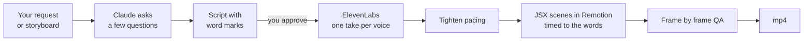

# jsxreel

**Narrated videos written like apps.** A Claude Code skill that rebuilds your app's screens in JSX, animates them with Remotion, voices them with ElevenLabs, and lands every frame on the spoken word.

Ask Claude for a video the way you'd ask for a feature: an app walkthrough, an announcement from a storyboard image, or a 30 second promo. jsxreel gives Claude the whole pipeline, from questions and script to voice, scenes, QA and the final mp4. One skill serves every project you have.

- [What it does](#what-it-does)
- [How it works](#how-it-works)
- [Install](#install)
- [Requirements](#requirements)
- [Set up a video project](#set-up-a-video-project)
- [Make a video](#make-a-video)
- [Script format](#script-format)
- [Tools](#tools)
- [Troubleshooting](#troubleshooting)
- [Privacy](#privacy)
- [License](#license)

## What it does

| Kind | You give Claude | You get |
|---|---|---|
| **App guide** | "Make a how to video for the leave flow" | The app's real screens rebuilt from its source code, with a finger tapping each button as the voice names it |
| **Storyboard announcement** | One storyboard image | Every panel redrawn and animated in the storyboard's own look, a voiced script, captions, and a click through demo for any "what you need to do" step |
| **Promo, reel or skit** | An idea for a 30 second ad | Characters in dialogue, music and sound effects, a hook on the first frame, and text kept clear of the Reels and TikTok buttons |

Every video comes out as an mp4, rendered on your machine, with a report of its length, anything Claude assumed, and what to check by ear.

## How it works



- **Screens as code.** Scenes are React components animated in [Remotion](https://www.remotion.dev). Screens are rebuilt from your app's code, so they match it exactly. No screen recordings, no slideshows.
- **One voice, one take.** Narration comes from [ElevenLabs](https://elevenlabs.io) in a single request per voice, so a voice never changes between lines. The take is then cut per line by its word timings.
- **Timed to the word.** Each script line carries `marks`, phrases whose spoken time drives the animation. Record a new take and the whole video retimes itself.
- **Tight pacing.** Natural speech feels slow on screen. `tighten.py` shortens long pauses and speeds the take up without spending new credits, and moves every mark with it.
- **Checked before done.** Claude checks on screen instructions against the vendor's current docs, gets your approval on the script before spending credits, and renders the exact frame of every tap or click to confirm it hits its target.

## Install

Pick one. All three install the same skill.

### Claude Code plugin (recommended)

Inside Claude Code:

```
/plugin install jsxreel --marketplace VisroliyaHimanshu/jsxreel
```

On Claude Code older than 2.1.275, add the marketplace first:

```
/plugin marketplace add VisroliyaHimanshu/jsxreel
/plugin install jsxreel@jsxreel
```

Claude uses it on its own when you ask for a video, or call it directly with `/jsxreel:jsxreel`. Updates come through the `/plugin` panel.

### npx

With the open [skills](https://skills.sh) installer, which also works for other coding agents:

```bash
npx skills add VisroliyaHimanshu/jsxreel -g -a claude-code
```

`-g` installs it for all your projects; leave it out to install into the current project only. Call it with `/jsxreel`.

### Manual

```bash
git clone https://github.com/VisroliyaHimanshu/jsxreel.git ~/Code/jsxreel
ln -s ~/Code/jsxreel/skills/jsxreel ~/.claude/skills/jsxreel
```

Update with `git -C ~/Code/jsxreel pull`. Call it with `/jsxreel`.

Open a new Claude Code session after installing so the skill is loaded.

## Requirements

| Tool | Why | Install (macOS) |
|---|---|---|
| [Claude Code](https://claude.com/claude-code) | Runs the skill | see claude.com/claude-code |
| Node.js 22 or newer | Remotion and the voice script | `brew install node` |
| ffmpeg | Cuts and measures audio | `brew install ffmpeg` |
| Python 3 | `tighten.py` | preinstalled, or `brew install python` |
| Google Chrome | Renders the video frames | google.com/chrome |
| ElevenLabs account | The voices | elevenlabs.io (an API key and a voice id) |

Remotion has its own licence: free for individuals, a paid licence for some companies. Check [remotion.pro/license](https://www.remotion.pro/license) for your case.

## Set up a video project

Each product keeps its videos in its own Remotion project, usually inside the product's repo. Claude sets this up for you when you ask for the first video, so you can skip this section. To do it yourself (no clone needed):

```bash
cd your-app
npx create-video@latest videos        # a blank Remotion project
cd videos
mkdir -p scripts qa
curl -fsSL https://raw.githubusercontent.com/VisroliyaHimanshu/jsxreel/main/skills/jsxreel/scripts/tts.mjs -o scripts/tts.mjs
curl -fsSL https://raw.githubusercontent.com/VisroliyaHimanshu/jsxreel/main/skills/jsxreel/scripts/tighten.py -o scripts/tighten.py
curl -fsSL https://raw.githubusercontent.com/VisroliyaHimanshu/jsxreel/main/skills/jsxreel/scripts/stills.mjs -o qa/stills.mjs
```

Add your ElevenLabs keys to `videos/.env` and make sure `.env` is in `.gitignore`:

```bash
ELEVENLABS_API_KEY=your_key
VOICE_ID=the_voice_you_picked
```

Then tell jsxreel about the project in `~/.claude/jsxreel/projects.md`:

```markdown
| Project | Folder | Read first | Voice | Conventions |
|---|---|---|---|---|
| My App guides | `~/Code/my-app/videos` | README.md | `node scripts/tts.mjs <video>` | Friendly tone, brand colours from src/theme, end on the support email |
```

This file lives outside the skill, so plugin updates never touch it and your paths and client names never leave your machine. Add a row per project; one skill serves them all.

## Make a video

Ask in plain words. Some examples:

| You say | What happens |
|---|---|
| "Make a how to video for uploading a document in the app" | Claude reads the screens in that flow, asks about format, length and ending, then writes the script |
| "Here is a storyboard image, turn it into a video" | Claude transcribes every panel into a flow table, flags problems in the copy, then asks before building |
| "Make a 30 second promo for the game, idea: everyone has a friend who..." | Claude drafts a skit with a cast of voices, music and sound effects |
| "The video is too long, speed it up" | Claude tightens the existing take, no new credits |
| "Change line 3 to say..." | Claude rerecords the take and the video retimes itself |

What to expect along the way:

1. **Questions first.** Up to four, with a recommended answer: format (vertical 1080×1920 by default), target length, how it ends, and anything only you can decide.
2. **Script approval.** You see every line in a table before any ElevenLabs credits are spent.
3. **Voice.** One take, cut per line, checked by transcription, then tightened.
4. **Build and QA.** Scenes are built and timed to the words; every tap and transition is checked frame by frame.
5. **Report.** The mp4 path, its exact length against your target, what Claude assumed (sample names, any UI label it could not verify), and what to listen for.

Claude never commits to git unless you ask.

## Script format

A video's narration lives in `scripts/<video>.json`:

```json
{
  "prefix": "doc",
  "lines": [
    {
      "text": "Tap Submit and wait for the upload. Your passport is now on record.",
      "marks": { "submit": "Submit", "done": "Your passport" }
    },
    {
      "text": "Our support line is 800 1234.",
      "say": "Our support line is eight hundred, twelve thirty four."
    }
  ]
}
```

| Field | Meaning |
|---|---|
| `prefix` | Short name for the audio files: `public/audio/<prefix>-line<i>.mp3` |
| `text` | What appears in captions |
| `say` | Optional. What the voice reads instead, for numbers, URLs and acronyms |
| `marks` | Optional. Name to phrase. The phrase must appear exactly (case sensitive) in the spoken line; its time is written to `voice.json` so the animation can fire on it |

In the video code, `m(line, "submit")` gives the second the voice says "Submit". The finger presses Submit right then.

## Tools

The skill's tools live in `skills/jsxreel/scripts/`. Claude runs them for you. To run them by hand, download them into the video project as shown in [Set up a video project](#set-up-a-video-project) and run them from its folder.

**`tts.mjs`** records one narrator in a single ElevenLabs request, normalises loudness, cuts it per line and writes `src/videos/<video>/voice.json` (clip lengths and mark times). Copy it into the video project's `scripts/`.

```bash
node scripts/tts.mjs <video>
```

Keys come from the project's `.env`, or from the file named in `ELEVENLABS_ENV`. Optional `ELEVEN_MODEL` (default `eleven_multilingual_v2`). It spends credits, so run it once per approved script.

**`tighten.py`** shortens pauses inside each line, trims the tail and speeds the take up, without new credits. Marks are remapped, so the video retimes on its own. Keep the untouched take in `.voice-orig/` first:

```bash
mkdir -p .voice-orig && cp public/audio/<prefix>-line*.mp3 src/videos/<video>/voice.json .voice-orig/
python3 -I scripts/tighten.py "$PWD" <video> <prefix>
```

| Flag | Default | Use |
|---|---|---|
| `--tempo` | `1.10` | Speed factor; pitch is kept |
| `--pause` | `0.28` | Longest pause kept inside a line, in seconds |
| `--keep LINE=SEC` | | A longer pause for one line, for example a click demo: `--keep 8=0.45` |

Running it again always starts from `.voice-orig/`, so you can try different settings safely.

**`stills.mjs`** renders chosen frames to PNG for checking, using one bundle. Copy it into the video project's `qa/`.

```bash
node qa/stills.mjs <CompositionId> 120 360 540
```

It uses Google Chrome at its macOS path; on another system, change `browserExecutable` at the top of the file.

## Troubleshooting

| Problem | Fix |
|---|---|
| Claude doesn't use the skill | Open a new session after installing. Check `/plugin` (plugin install) or `~/.claude/skills/jsxreel` (npx or manual) |
| `ELEVENLABS_API_KEY or VOICE_ID missing` | Add both to the video project's `.env`, or point `ELEVENLABS_ENV` at your env file |
| `HTTP 401` (or another code) from ElevenLabs | The message printed after the code says which: a wrong key, or the plan is out of credits |
| `line 3: mark "submit" phrase not found` | The phrase must match the spoken line exactly, including capitals. Check `say` if the line has one |
| The voice changes between lines | Lines were recorded separately. Record the whole script in one take |
| The render can't find a browser | Add `--browser-executable "/Applications/Google Chrome.app/Contents/MacOS/Google Chrome"` |
| Port already in use | Add `--port=3917` (or any free port) to `remotion studio` and `remotion render` |
| A tap lands before the screen appears | Give that scene a longer lead in, or move the tap later in the timeline |

## Privacy

- Your project list lives in `~/.claude/jsxreel/projects.md`, outside the skill and outside git.
- Never commit `.env`. Keys are loaded at runtime and never printed.
- Claude flags personal data in images you supply (names, phone numbers, emails) and asks before it goes into a video. Secrets such as a live QR code never appear on screen.

## License

[MIT](LICENSE) © 2026 Himanshu Visroliya
